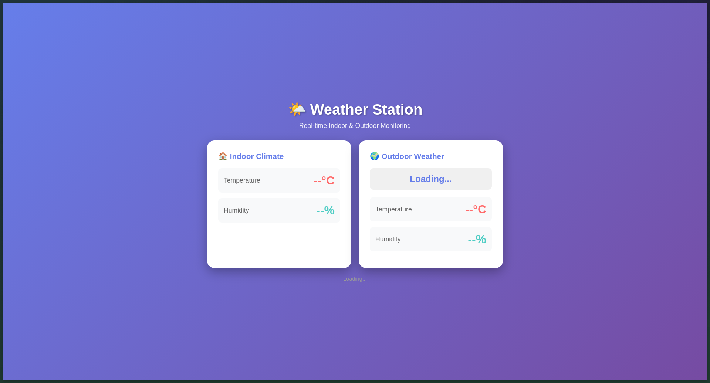

# 🌤️ ESP32 Smart Weather Station

A comprehensive IoT weather monitoring system built with an ESP32, a DHT11 sensor, and an I2C LCD display. This project features a beautiful, responsive web dashboard to display real-time indoor climate metrics alongside outdoor weather data fetched from the OpenWeatherMap API.

## Team

|Member|GitHub Profile|
|:----:|:-------------:|
| Adam Kamal | [@adaamk](https://github.com/adaamk) |
| Ahmed Bahaa | [@Ahmed-Mazen](https://github.com/Ahmed-Mazen) |
| Ahmed ELwakeel | [@ahmedelwakeel8](https://github.com/ahmedelwakeel8) |
| Ahmed Hany | [@Ahmedd-hanii](https://github.com/Ahmedd-hanii) |
| Mohamed Mamdouh | [@MohamedAlmaasarawy](https://github.com/MohamedAlmaasarawy) |
| Mohamed Tamer | [@Mohamed393652](https://github.com/Mohamed393652) |

## ✨ Features

* **Indoor Monitoring:** Real-time temperature and humidity readings using a DHT11 sensor.
* **Outdoor Weather:** Fetches current outdoor temperature, humidity, and weather conditions via the OpenWeatherMap API.
* **Physical Display:** Shows vital stats locally on a 16x2 I2C LCD screen.
* **Web Dashboard:** A stylish, responsive HTML/CSS dashboard hosted directly on the ESP32.
* **Asynchronous Updates:** The web interface automatically updates every 2 seconds without refreshing the page (via JSON endpoints).

## 🛠️ Hardware Requirements

* ESP32 Development Board
* DHT11 Temperature & Humidity Sensor
* 16x2 LCD Display with I2C module (Address: `0x27`)
* Breadboard & Jumper Wires
* Micro-USB or USB-C cable for programming and power

## 📚 Software Dependencies

You will need the Arduino IDE with the ESP32 board manager installed. Additionally, install the following libraries via the Arduino Library Manager:

* `ArduinoJson` by Benoit Blanchon (Used for parsing API responses)
* `DHT sensor library` by Adafruit
* `LiquidCrystal I2C` by Frank de Brabander

*Note: `WiFi.h`, `HTTPClient.h`, `Wire.h`, and `WebServer.h` are built-in libraries for the ESP32.*

## 🔌 Wiring Guide

| Component | Pin | ESP32 Pin |
| :--- | :--- | :--- |
| **DHT11** | VCC | 3.3V |
| | GND | GND |
| | DATA | GPIO 4 |
| **I2C LCD** | VCC | 5V / VIN |
| | GND | GND |
| | SDA | GPIO 21 (Default SDA) |
| | SCL | GPIO 22 (Default SCL) |

*(Note: Double-check your specific ESP32 board's pinout, as default I2C pins can occasionally vary).*

## 🚀 Setup & Installation

1. **Clone the repository** (or download the source code).
2. **Open the code** in the Arduino IDE.
3. **Configure your WiFi:**
   ```cpp
   const char* ssid = "YOUR_WIFI_SSID";
   const char* password = "YOUR_WIFI_PASSWORD";
   ```
4. **Get an OpenWeatherMap API Key:**
   * Sign up for a free account at [OpenWeatherMap](https://openweathermap.org/).
   * Generate an API key and update the following variables:
   ```cpp
   const char* apiKey = "YOUR_API_KEY";
   const char* city = "Giza";  // Change to your city
   const char* countryCode = "EG"; // Change to your country's code
   ```
5. **Upload the code** to your ESP32.
6. **Open the Serial Monitor** (baud rate `115200`) to find the IP address assigned to your ESP32.

## 📱 Usage

Once the ESP32 connects to your WiFi network, it will print its local IP address on the physical LCD screen and the Serial Monitor (e.g., `192.168.1.100`). 

Simply open a web browser on any device connected to the same network and navigate to that IP address to view your Web Dashboard!

## 📸 Dashboard Preview

